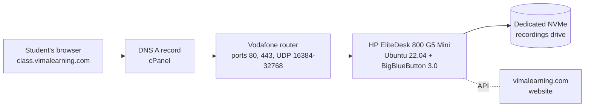

# Self-hosted BigBlueButton Class Server for Vibrant Minds Learning

A production virtual classroom built on a refurbished mini PC at home, serving live, auto-recorded online tutoring for [Vibrant Minds Learning](https://vimalearning.com) at `https://class.vimalearning.com`, without a paid video subscription.

## The problem

Vibrant Minds Learning runs one-to-one and small-group tutoring for UK students in Years 3 to 11. The goal was for every class to be recorded automatically and appear on the student's dashboard, without paying per-user for Microsoft Teams, Zoom or Google Meet, and while keeping children's recordings under the school's own control (UK GDPR).

## The solution

An open-source [BigBlueButton](https://bigbluebutton.org) 3.0 server hosted on a dedicated mini PC at home, reached over a business-grade static IP and a dedicated subdomain. The website will create classes with recording forced on and fetch recordings through BigBlueButton's API.

## Stack

| Layer | Choice |
| --- | --- |
| Hardware | HP EliteDesk 800 G5 Mini: Intel Core i5-9500 (6 cores), 16 GB RAM, Samsung SATA SSD (system) + WD NVMe (recordings) |
| Operating system | Ubuntu Server 22.04.5 LTS |
| Conferencing | BigBlueButton 4.0, upgraded from 3.0 (nginx, FreeSWITCH, WebRTC, recording pipeline); no Greenlight front end |
| TLS | Let's Encrypt via `bbb-install.sh` |
| Network | Vodafone Full Fibre 500 (68 Mbps upload), static public IPv4, router port forwarding |
| DNS | A record in cPanel (Namecheap hosting) |
| Remote admin | Tailscale private network with Tailscale SSH; no SSH exposed to the internet |
| Firewall | UFW, opened only for 80/tcp, 443/tcp, 16384-32768/udp, 3478 |

## What I did

- **Sized and sourced the hardware.** Compared cloud servers (about £110 to £170 a month), managed hosting and home hosting; benchmarked a dozen used PCs against BigBlueButton's requirements and chose a 65 W 6-core mini PC for £188.
- **Secured the network path.** Verified the line was not behind CGNAT, obtained a static IPv4 from the ISP, created the DNS record, reserved a local IP and forwarded only the required ports.
- **Built the server.** Installed Ubuntu 22.04 on the SATA SSD, put recordings on their own NVMe drive mounted at `/var/bigbluebutton`, disabled sleep, and installed BigBlueButton 3.0 with automatic HTTPS.
- **Fixed behind-NAT media.** Diagnosed and corrected the FreeSWITCH SIP address so WebRTC audio works for users outside the home network.
- **Tested from outside.** Verified external reachability over 4G, HTTPS, and the BigBlueButton API; a full class test (audio, video, screen sharing, recording) is the final step before go-live.
- **Documented everything.** Wrote a step-by-step [setup guide](docs/SETUP.md) and a [troubleshooting log](docs/TROUBLESHOOTING.md) of 16 real errors with causes and fixes.

## Problems solved

| Problem | Root cause | Fix |
| --- | --- | --- |
| Installer refused to run | Ubuntu 26.04 installed; BBB 3.0 needs 22.04 | Reinstalled 22.04.5 |
| USB installer would not boot, BIOS ignored keyboard | Secure Boot block list updated by 26.04; USB boot entry inactive | Booted the ISO from a spare drive via a custom GRUB entry |
| TLS certificate failed with a connection timeout | Router port rules had not saved | Re-added and verified rules; tested from outside the LAN |
| Microphones would not connect | FreeSWITCH SIP address set to the public IP behind NAT | Set `freeswitch.sip_ip` to the LAN address |
| API `checksumError` | Shared secret mistyped | Rotated to a hex secret; never shared on screen |
| Public Sign in / Sign up page appeared after upgrading to 4.0 | Greenlight v3 front end served on `/` | Disabled Greenlight in nginx ([write-up](docs/SECURITY-FIX-GREENLIGHT.md)) |
| `500 Internal Server Error` on the domain after disabling Greenlight | Default front end had also been disabled, so nginx had no handler for `/` | Re-enabled `default-fe.nginx`, `nginx -t`, reload |

## Repository contents

- [`docs/SETUP.md`](docs/SETUP.md): the full build, phase by phase, with screenshots.
- [`docs/TROUBLESHOOTING.md`](docs/TROUBLESHOOTING.md): every error met, its cause and fix.
- [`docs/SECURITY-FIX-GREENLIGHT.md`](docs/SECURITY-FIX-GREENLIGHT.md): removing the public Greenlight portal, the 500 error it caused, and Tailscale-only admin access.
- [`scripts/`](scripts/): the commands used, as small reviewed scripts.

## Security considerations

The server holds recordings of children's lessons, so it was built to expose as little as possible.

| Area | Control |
| --- | --- |
| No public front end | Greenlight (public sign-up and rooms) disabled in nginx; the site root shows only the default page. Meetings are created only by the school website through the API. |
| Attack surface | Router forwards only 80/tcp, 443/tcp and 16384-32768/udp (plus 3478 for TURN). SSH (22) is **not** exposed to the internet. |
| Host firewall | UFW enabled by the installer (`-w`), default deny inbound, allowing only the ports above. |
| Transport | HTTPS enforced with an auto-renewing Let's Encrypt certificate; WebRTC media is encrypted (DTLS-SRTP). |
| Remote admin | Port 22 never forwarded. Off-site administration only over Tailscale (WireGuard) with Tailscale SSH (`tailscale set --ssh`), so login is tied to the admin's identity. |
| API secret | 128-bit random hex (`openssl rand -hex 16`), read only on the server, stored only in the website's private `.env`; rotated immediately after it appeared in a screenshot. |
| Recording control | Classes are created with `record=true`, `autoStartRecording=true`, `allowStartStopRecording=false`, so tutors cannot pause recordings. |
| Data separation | Recordings on a dedicated drive; the family home cloud runs on a separate machine. |
| Patching | Monthly OS updates; BigBlueButton updated by re-running the installer. `do-release-upgrade` is never run (BBB 3.0 supports 22.04 only). |
| Privacy (UK GDPR) | Parental consent, access limited to student, parent, tutor and admin; recordings kept one school year. |
| Publication hygiene | No secrets in this repository (`.gitignore` blocks `.env` files). The shared secret, passwords, public IP and MAC address are removed or blurred in all text and screenshots. |

Planned hardening: stop the now-unused Greenlight containers, SSH key-only login with password authentication disabled, `fail2ban`, unattended security upgrades, off-site encrypted recording backups, and uptime monitoring.

## Status

Server live and passing `bbb-conf --check` with no warnings. Next: full class test, then website integration (auto-recorded classes, recordings on student dashboards, admin scheduling).
