# Setup guide

How the BigBlueButton server at `class.vimalearning.com` was built. Follow the phases in order; each depends on the one before.

Values used below (replace with your own):

| Item | Value |
| --- | --- |
| Server name / user | `vimabbb` / `vimaadmin` |
| Local IP | `192.168.1.178` (reserved in the router) |
| Public IP | your static IPv4 (shown here as `<PUBLIC_IP>`) |
| Domain | `class.vimalearning.com` |
| System drive | Samsung SATA SSD (`sda`, 232.9G) |
| Recordings drive | WD NVMe (`nvme0n1`, 238.5G) |

Never photograph or commit the BigBlueButton shared secret or any password.

## Phase 1: Network and domain

1. **Upload speed.** Test by cable at speedtest.net. Measured 68 Mbps up; each 1-to-1 class needs about 2-4 Mbps.
2. **No CGNAT.** The router's WAN IPv4 must match whatismyip.com. Addresses starting `100.64`-`100.127`, `10.` or `192.168.` mean CGNAT, and hosting will not work.
3. **Static IP.** Requested free from Vodafone through live chat (ask for a human agent; the chatbot may say it is not offered).
4. **DNS A record.** In the DNS host (here cPanel > Zone Editor): type `A`, name `class`, address `<PUBLIC_IP>`.
5. **Check** at dnschecker.org that `class.vimalearning.com` returns `<PUBLIC_IP>` everywhere.

## Phase 2: Install Ubuntu Server 22.04

BigBlueButton 3.0 installs only on Ubuntu 22.04 ("jammy").

1. Confirm the hardware in Windows before wiping it (CPU, RAM, both drives).

   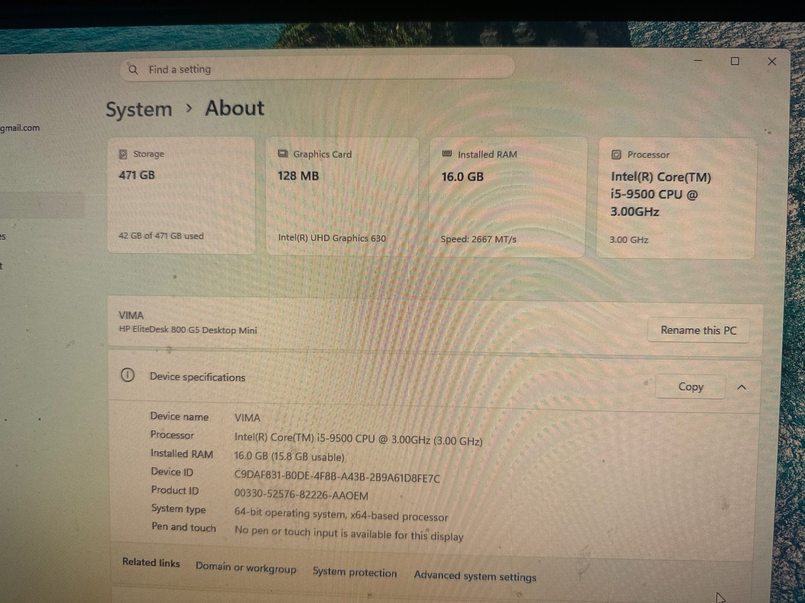
   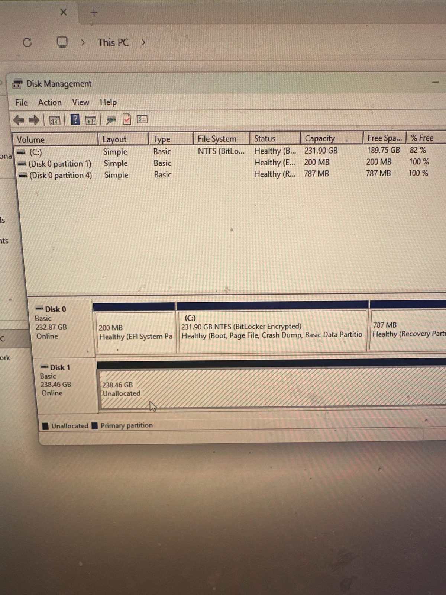

2. Download `ubuntu-22.04.5-live-server-amd64.iso` from <https://releases.ubuntu.com/22.04/> and write it to a USB stick (Rufus, balenaEtcher, or `dd`):

   ```bash
   sudo dd if=ubuntu-22.04.5-live-server-amd64.iso of=/dev/sdX bs=4M status=progress conv=fsync
   ```

   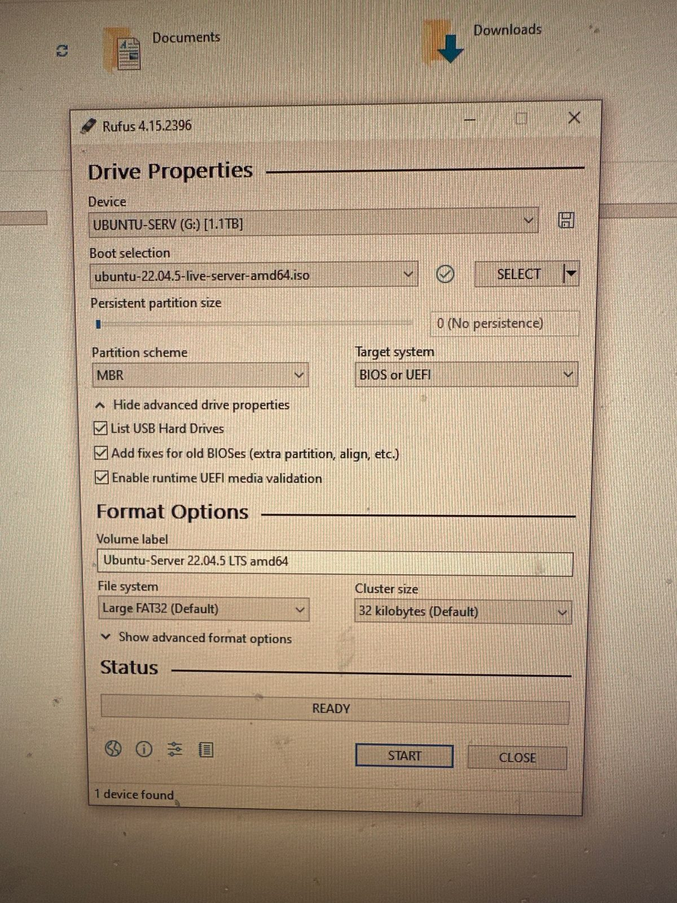

3. Boot it (HP: F9 boot menu). If USB boot is blocked, see [Troubleshooting](TROUBLESHOOTING.md#booting-the-installer-from-another-drive).
4. Installer choices:

   | Screen | Choice |
   | --- | --- |
   | Installer update | Continue without updating |
   | Install type | Ubuntu Server (not minimized) |
   | Storage | Use an entire disk: the **SATA SSD**; **untick LVM**; no encryption |
   | Profile | server `vimabbb`, user `vimaadmin`, strong password |
   | SSH | Install OpenSSH server |
   | Snaps | none |

   Wrong (Ubuntu on the NVMe, LVM on):

   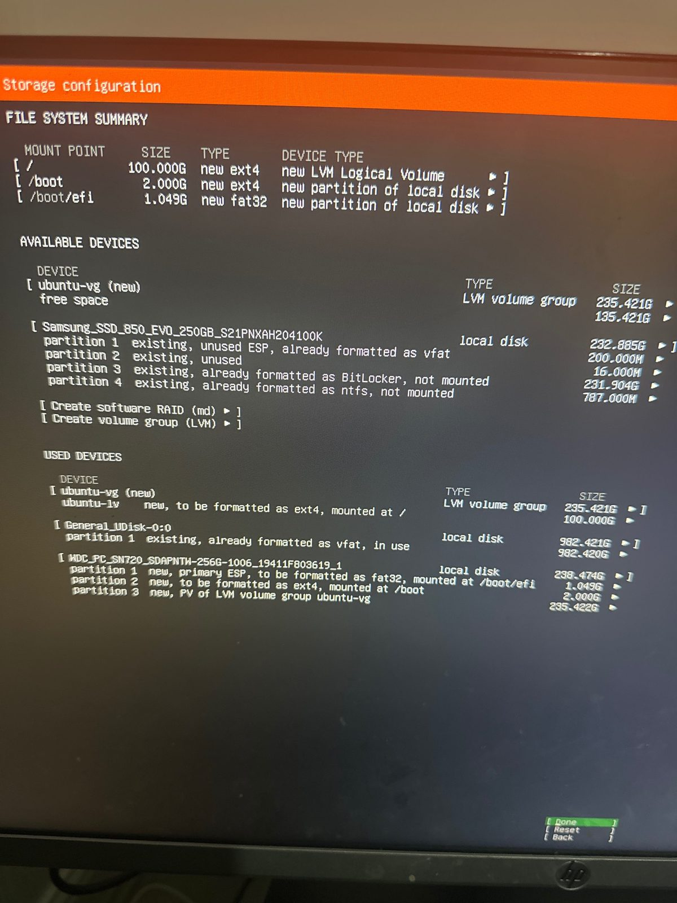

   Right:

   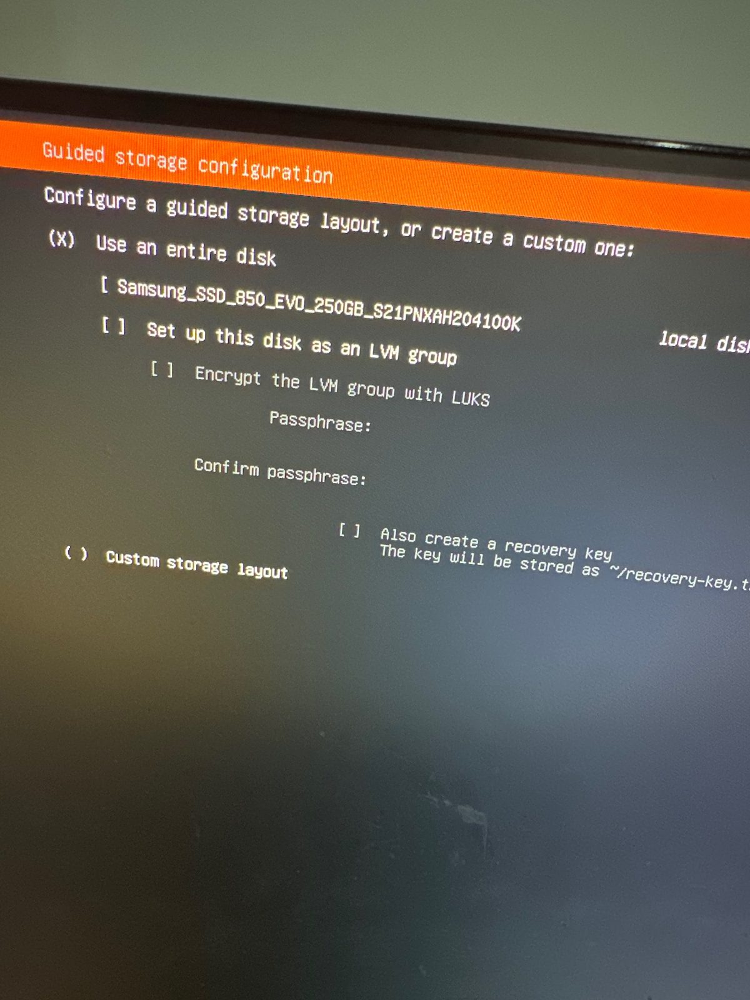
   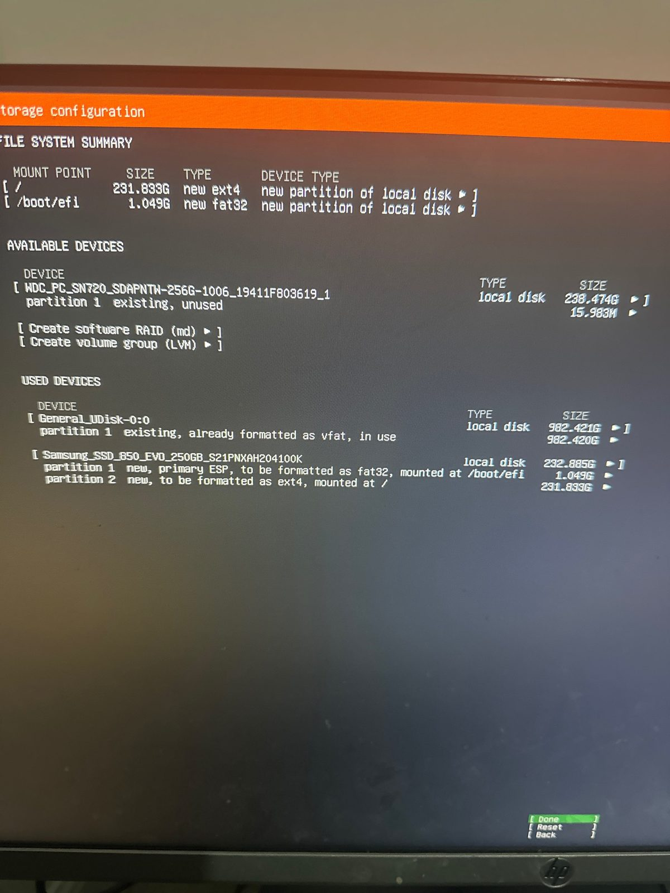

5. First login, one command per line:

   ```bash
   sudo apt update
   sudo apt upgrade -y
   sudo timedatectl set-timezone Europe/London
   sudo systemctl mask sleep.target suspend.target hibernate.target hybrid-sleep.target
   ```

   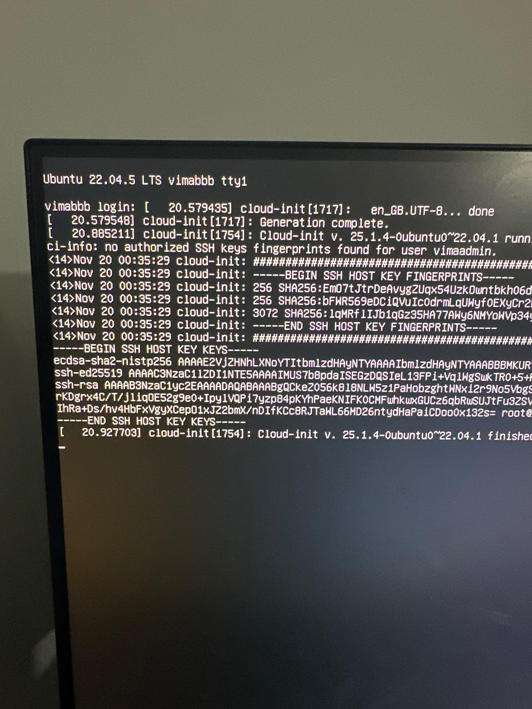

   Never run `do-release-upgrade` on this server.

## Phase 3: Recordings drive

Recordings get their own drive so they cannot fill the system drive. Do this before installing BigBlueButton. See [`scripts/01-recordings-drive.sh`](../scripts/01-recordings-drive.sh).

```bash
sudo wipefs -a /dev/nvme0n1
sudo parted /dev/nvme0n1 --script mklabel gpt mkpart recordings ext4 0% 100%
sudo mkfs.ext4 -L recordings /dev/nvme0n1p1
sudo mkdir -p /var/bigbluebutton
echo 'LABEL=recordings /var/bigbluebutton ext4 defaults,nofail 0 2' | sudo tee -a /etc/fstab
sudo mount -a
df -h /var/bigbluebutton
```

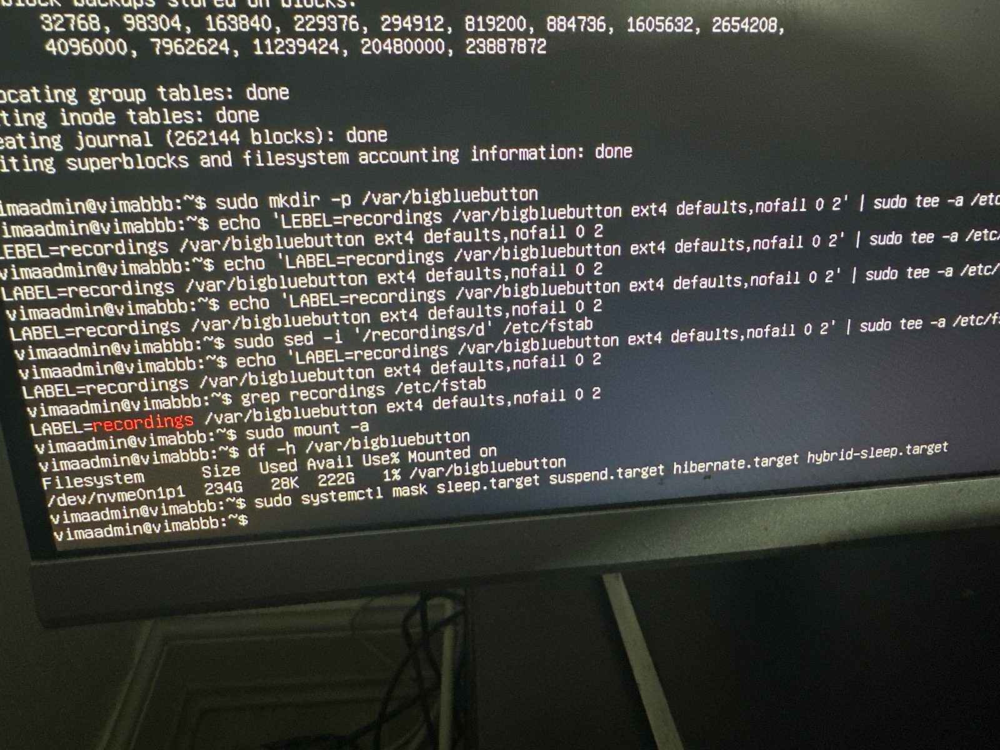

## Phase 4: Router

1. **Reserve the server's IP** (Vodafone Power Hub: Settings > Local Network > Static DHCPv4): one row for the server's MAC, `192.168.1.178`. Delete duplicates.

   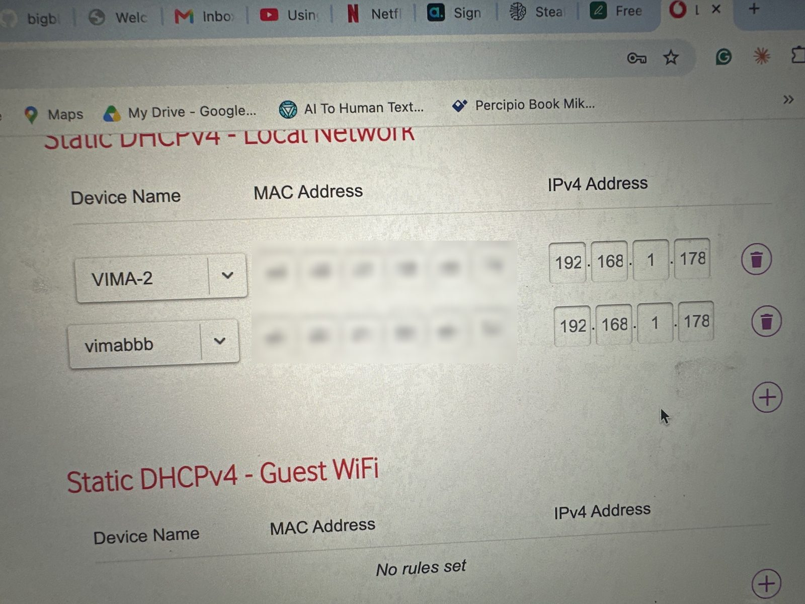

2. **Port mapping** (Internet > IPv4 Port Mapping > Static, Expert Mode on):

   | Name | Protocol | Port(s) | To |
   | --- | --- | --- | --- |
   | bbb-http | TCP | 80 | 192.168.1.178 |
   | bbb-https | TCP | 443 | 192.168.1.178 |
   | bbb-media | UDP | 16384-32768 | 192.168.1.178 |

   Optional: TCP and UDP 3478. Save, **refresh the page, and confirm the rules are still listed.** Do not forward port 22.

   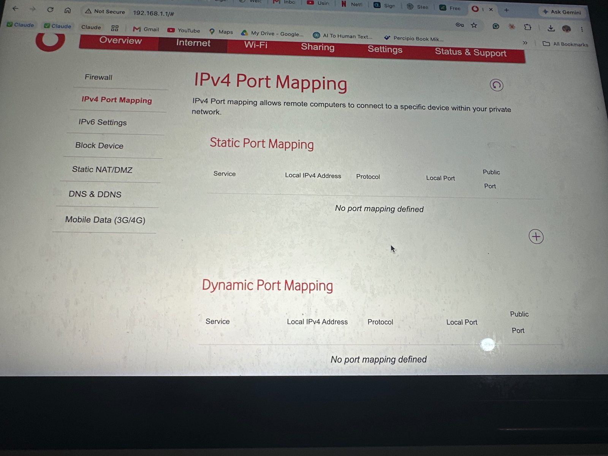
   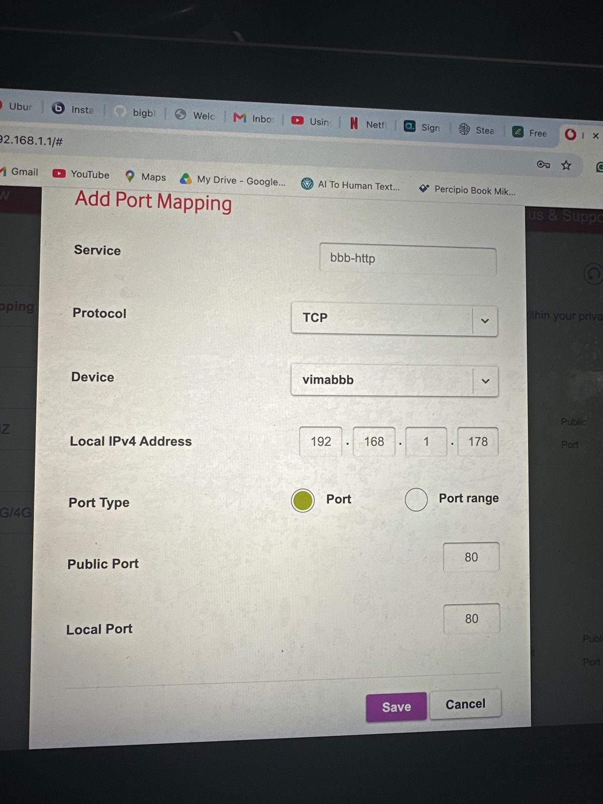
   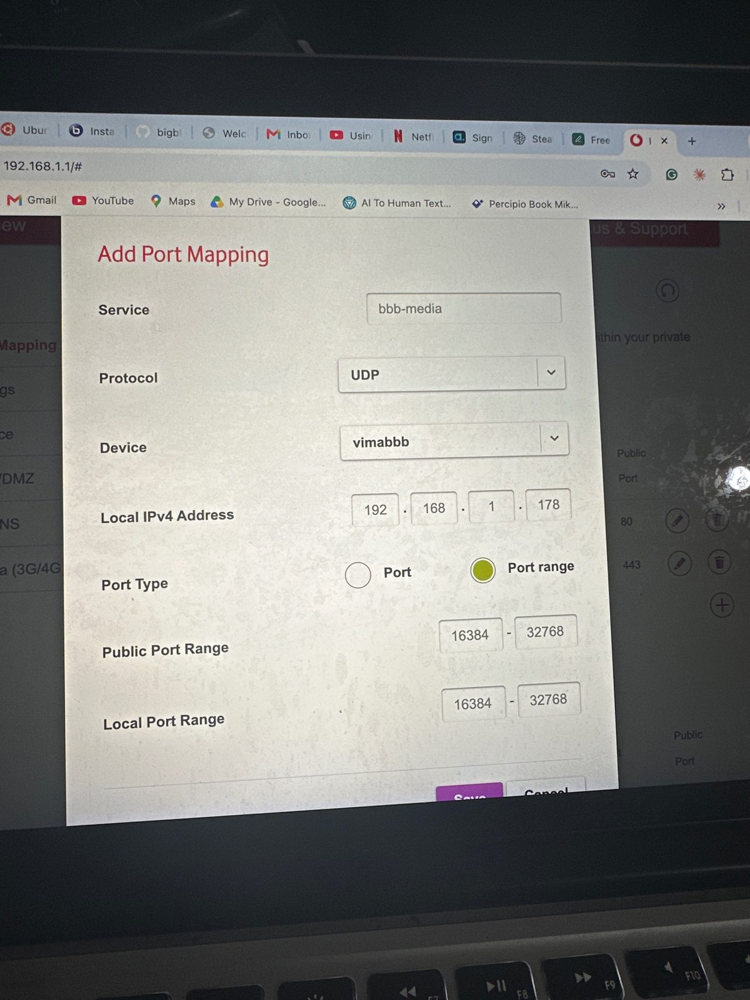

3. **Test from outside** on a phone with Wi-Fi off: `http://class.vimalearning.com` should return an nginx page. A laptop on the home Wi-Fi is not a valid test (no NAT loopback).

## Phase 5: Install BigBlueButton

See [`scripts/02-install-bbb.sh`](../scripts/02-install-bbb.sh).

```bash
wget https://raw.githubusercontent.com/bigbluebutton/bbb-install/v3.0.x-release/bbb-install.sh -O bbb-install.sh
sudo bash bbb-install.sh -w -v jammy-300 -s class.vimalearning.com -e <ADMIN_EMAIL>
sudo bbb-conf --check
```

Behind a home router, the check warns that `bbb-webrtc-sfu` will connect to the public IP while FreeSWITCH listens on the LAN address. Fix it ([`scripts/03-fix-nat-sip.sh`](../scripts/03-fix-nat-sip.sh)):

```bash
sudo yq e -i '.freeswitch.sip_ip = "192.168.1.178"' /etc/bigbluebutton/bbb-webrtc-sfu/production.yml
sudo yq e '.freeswitch.sip_ip' /etc/bigbluebutton/bbb-webrtc-sfu/production.yml
sudo chown bigbluebutton:bigbluebutton /etc/bigbluebutton/bbb-webrtc-sfu/production.yml
sudo bbb-conf --restart
sudo bbb-conf --check
```

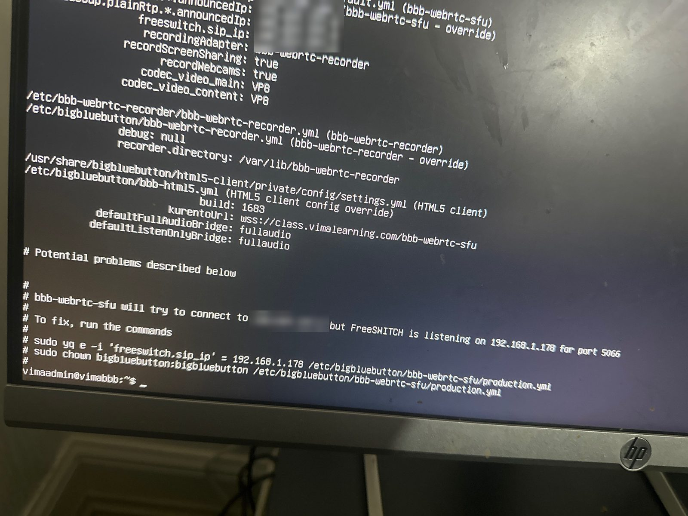
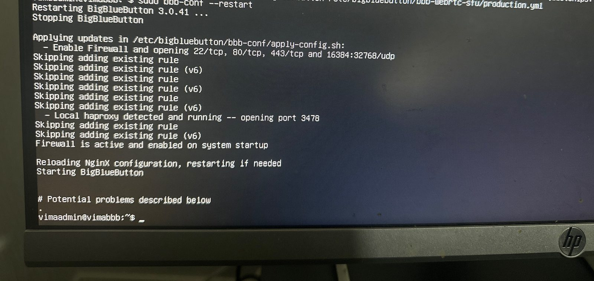

## Phase 6: Test and secure the API secret

1. Set an easy-to-type hex secret and read it on the server only:

   ```bash
   sudo bbb-conf --setsecret $(openssl rand -hex 16)
   sudo bbb-conf --restart
   sudo bbb-conf --secret
   ```

2. In [API Mate](https://bigbluebutton.org/api-mate/): server `https://class.vimalearning.com/bigbluebutton/`, the secret, `record` and `autoStartRecording` on, `allowStartStopRecording` off. Open **create** (expect `SUCCESS` with a meetingID), then **join as moderator**, then **join as attendee** on a phone using mobile data. Check audio both ways, camera and screen share.
3. After ending the meeting: `sudo bbb-record --list`.

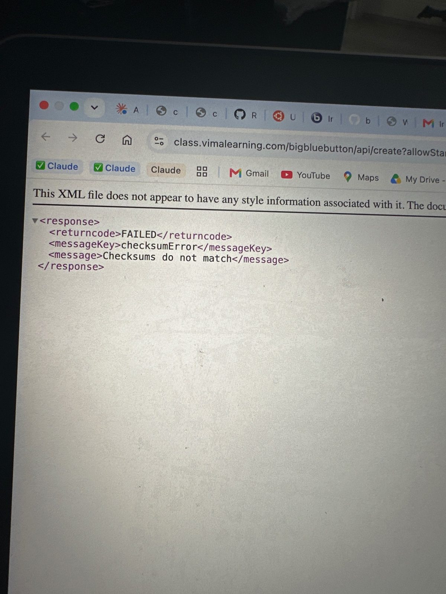

## Maintenance

| When | Task | Command |
| --- | --- | --- |
| Monthly | Security updates | `sudo apt update && sudo apt upgrade -y`, then `sudo reboot` |
| Every 1-2 months | Update BigBlueButton | re-run the install command, then re-check `freeswitch.sip_ip` |
| Weekly | Recording space | `df -h /var/bigbluebutton` |
| Any time | Health | `sudo bbb-conf --check` |
| Once | Restart after power loss | BIOS > Advanced > Boot Options > After Power Loss = Power On |

Remote access: `ssh vimaadmin@192.168.1.178` on the LAN; Tailscale off-site.
