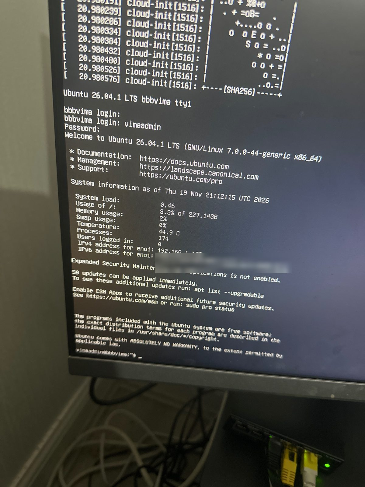
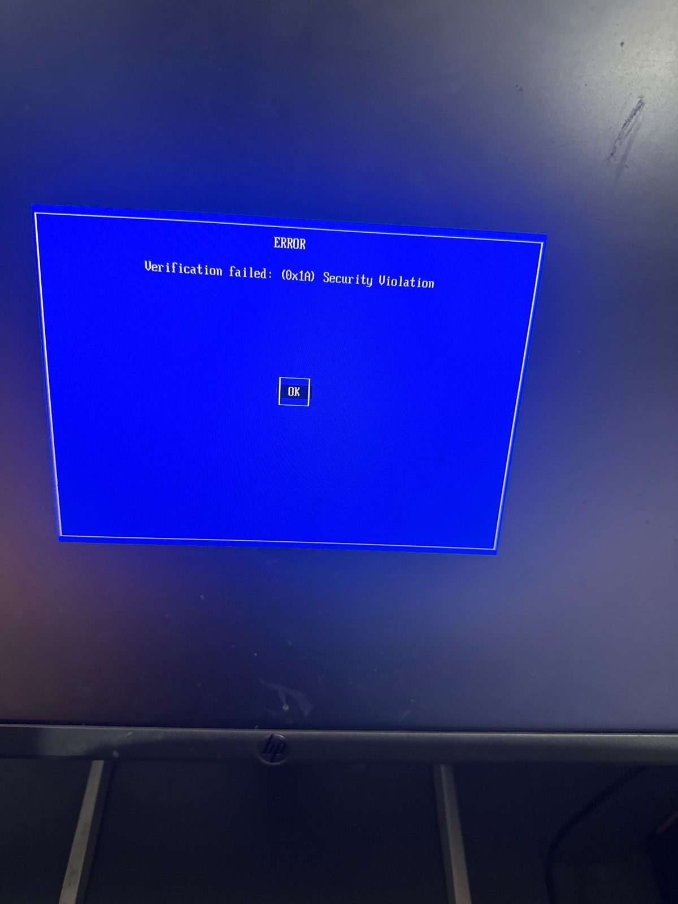
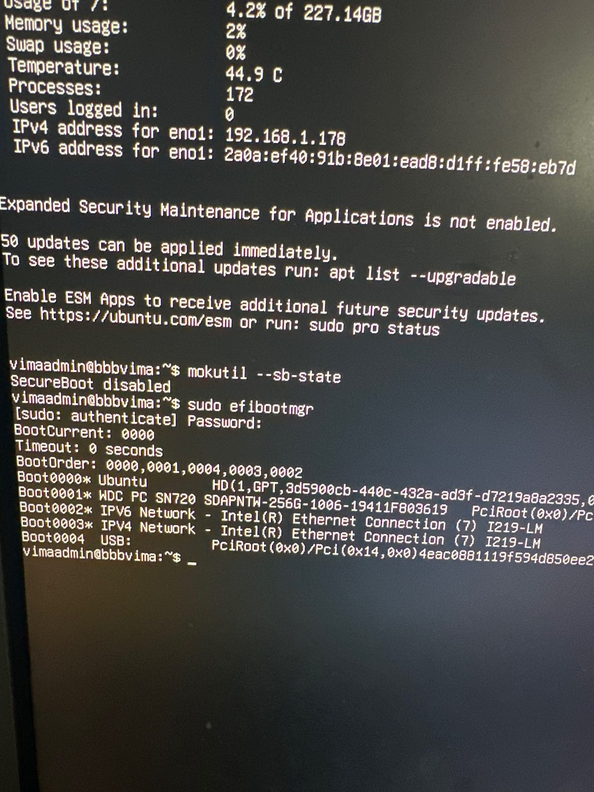
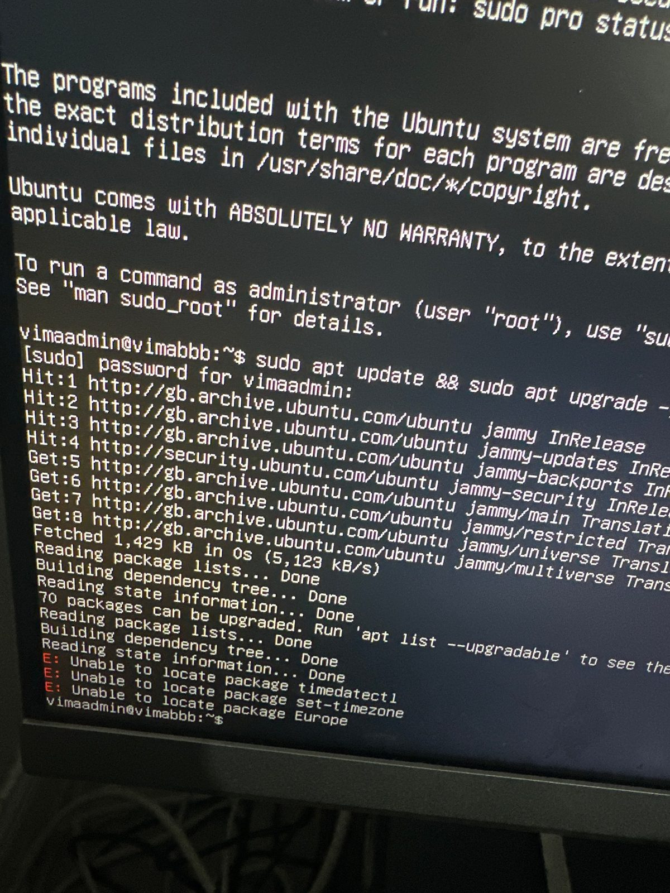
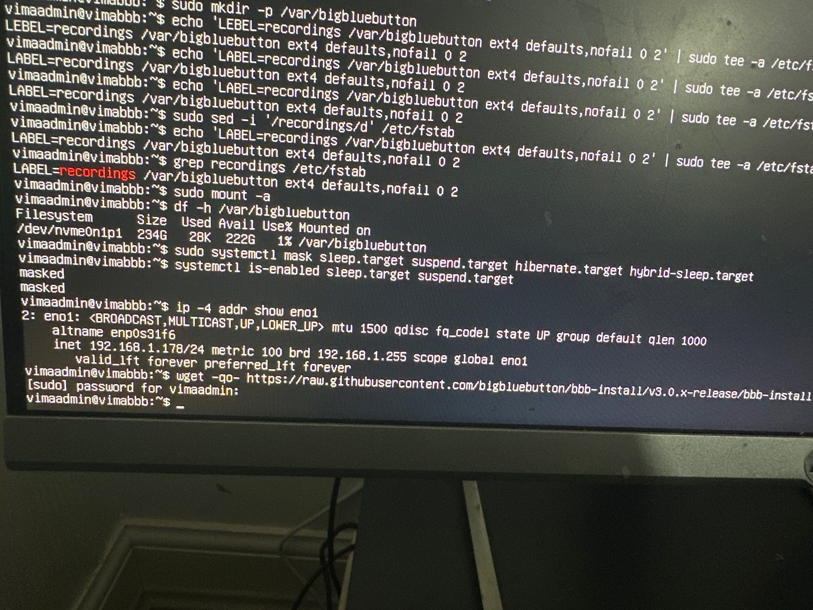
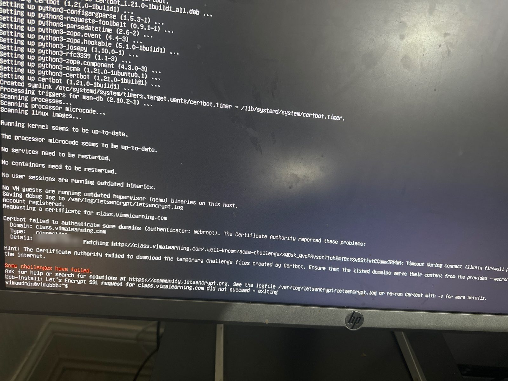
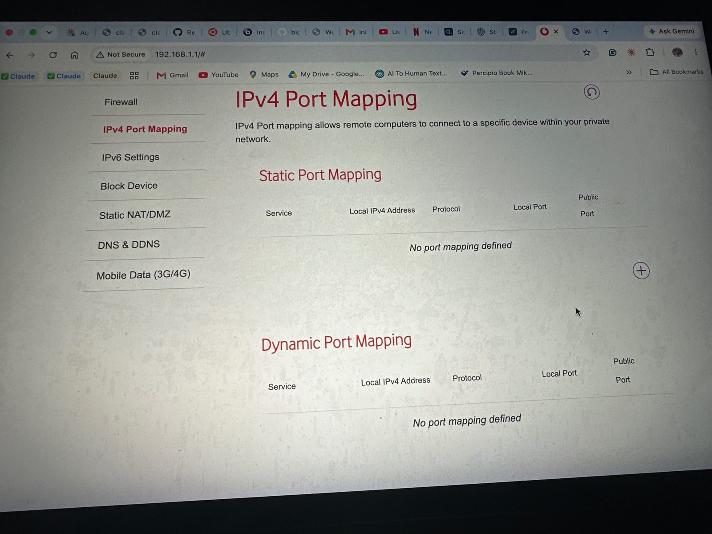
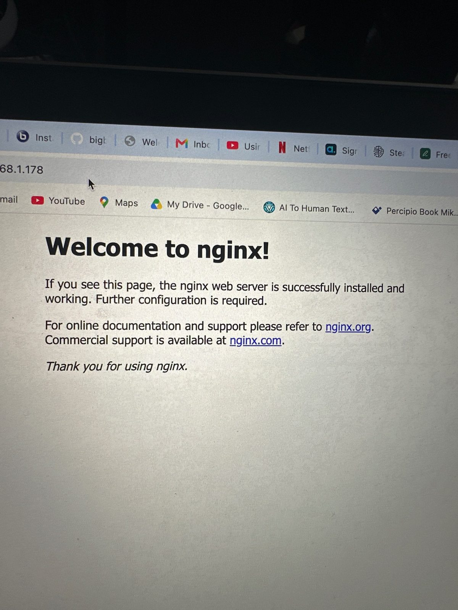
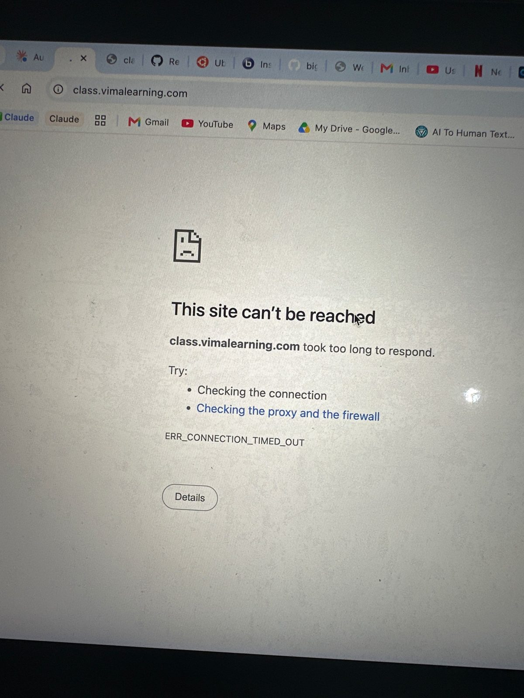
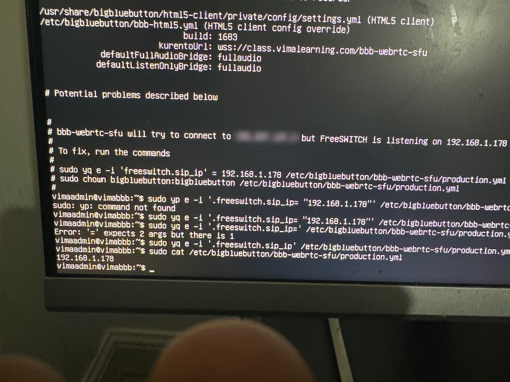

# Troubleshooting log

Every problem met during the build, in order. Find the symptom, check the cause, apply the fix.

| # | Symptom | Cause | Fix |
| --- | --- | --- | --- |
| T1 | Welcome text says **Ubuntu 26.04** | Wrong ISO | Reinstall from `ubuntu-22.04.5-live-server-amd64.iso` |
| T2 | **Security Violation** booting the 22.04 stick | 26.04 updated the firmware's Secure Boot block list | BIOS > Secure Boot Configuration > Secure Boot Disable |
| T3 | USB never boots; keyboard and mouse dead in BIOS | Wireless keyboard receiver; USB boot entry inactive (`Boot0004 USB:` without `*`) | Wired keyboard in a rear port; otherwise boot the ISO from another drive (below) |
| T4 | Rufus stick not listed by firmware | One large FAT32 partition | Rewrite with `dd`; verify with `sudo cmp -n <iso-size> *.iso /dev/sdX && echo STICK OK` |
| T5 | `apt` tries to install `timedatectl` and `Europe` | Two commands on one line | One command per line |
| T6 | `Isblk: command not found` | Capital I for lowercase L | `lsblk` |
| T7 | fstab line saved as `LEBEL=` or twice | Typo, then retyped | `sudo sed -i '/recordings/d' /etc/fstab`, add once, check with `grep` |
| T8 | Installer returns instantly | `wget -qo-` (lowercase o) | Use `-O`, or download then run separately |
| T9 | `Certbot failed ... Timeout during connect` | Port 80 not reaching the server; router rules not saved | Re-add rules, refresh to confirm, retest from 4G, re-run installer |
| T10 | Times out from a laptop at home | No NAT loopback on the router | Not a fault: test from a phone on mobile data |
| T11 | 500 Internal Server Error (nginx) from 4G | Ports work; BBB install unfinished | Re-run the installer |
| T12 | `bbb-webrtc-sfu will try to connect to <PUBLIC_IP> but FreeSWITCH is listening on 192.168.1.178` | Normal behind NAT | Set `freeswitch.sip_ip` to the LAN IP |
| T13 | `sudo: yp: command not found` | Typo | `yq` |
| T14 | `Error: '=' expects 2 args but there is 1` | Missing value after `=` | `'.freeswitch.sip_ip = "192.168.1.178"'` |
| T15 | `production.yml` contains only an IP | `-i` used on a read command overwrote the file | `echo '{}' \| sudo tee /etc/bigbluebutton/bbb-webrtc-sfu/production.yml`, re-run installer, re-apply fix |
| T16 | API Mate `checksumError` | Secret mistyped | Set a hex secret and retype carefully |

## Booting the installer from another drive

Use when the BIOS will not boot USB but an existing Ubuntu install is running. The spare drive is reformatted later for recordings.

```bash
sudo wipefs -a /dev/nvme0n1
sudo parted /dev/nvme0n1 --script mklabel gpt mkpart isotemp ext4 0% 100%
sudo mkfs.ext4 -F -L isotemp /dev/nvme0n1p1
sudo mkdir -p /mnt/isotemp
sudo mount /dev/nvme0n1p1 /mnt/isotemp
sudo cp ubuntu-22.04.5-live-server-amd64.iso /mnt/isotemp/u.iso
sudo nano /etc/grub.d/40_custom
```

Append:

```
menuentry "Install Ubuntu 22.04" {
  insmod ext2
  insmod loopback
  search --no-floppy --set=root --label isotemp
  loopback loop /u.iso
  linux (loop)/casper/vmlinuz iso-scan/filename=/u.iso ---
  initrd (loop)/casper/initrd
}
```

Then:

```bash
sudo sed -i 's/^GRUB_DEFAULT=.*/GRUB_DEFAULT=saved/' /etc/default/grub
sudo update-grub
sudo grub-reboot "Install Ubuntu 22.04"
sudo reboot
```

## Screenshots

| | |
| --- | --- |
| T1 Ubuntu 26.04 by mistake |  |
| T2 Secure Boot violation |  |
| T3 USB boot entry inactive |  |
| T5 Two commands on one line |  |
| T8 `wget -qo-` |  |
| T9 Certificate timeout |  |
| T9 Port mapping table empty |  |
| T10 nginx works locally |  |
| T10 Timeout from inside the LAN |  |
| T11 500 error on 4G |  |
| T15 Overwritten production.yml |  |

## Useful diagnostics

```bash
sudo bbb-conf --check                       # health
sudo ss -tlnp | grep ':80 '                 # is nginx listening
sudo ufw status                             # host firewall
sudo tail -n 3 /var/log/nginx/*access*.log  # did outside visits arrive
sudo tcpdump -ni eno1 tcp port 80           # watch incoming traffic live
sudo efibootmgr                             # boot entries (* = active)
```
